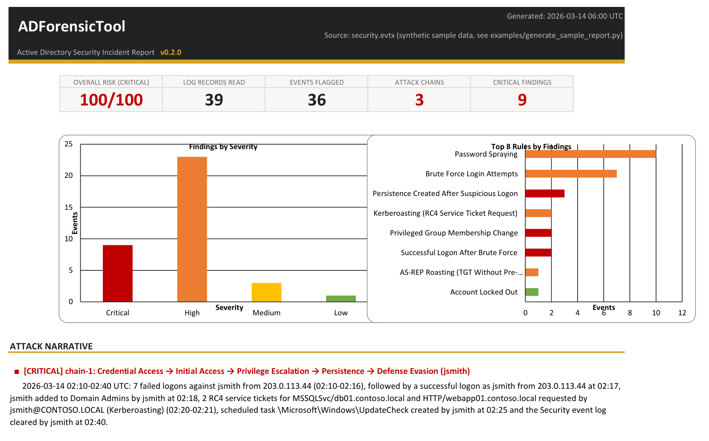
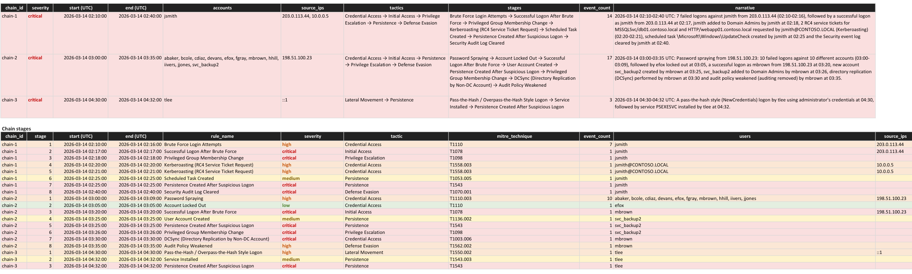

# ADForensicTool

[](https://github.com/rumenjordanov/ADForensicTool/actions/workflows/tests.yml)


Analyzes Windows/Active Directory **Security** event logs (`.evtx` exports
from Domain Controllers) after a suspected breach and reconstructs an
attack narrative — flagged events stitched into chains showing how an
attacker moved through the environment (brute force → successful logon →
privilege escalation → persistence), each told as one plain-English,
timestamp-anchored sentence:

> 2026-03-14 03:00-03:35 UTC: Password spraying from 198.51.100.23: 10 failed
> logons against 10 different accounts (03:00-03:09), followed by efox locked
> out at 03:05, a successful logon as mbrown from 198.51.100.23 at 03:20, new
> account svc_backup2 created by mbrown at 03:25, svc_backup2 added to Domain
> Admins by mbrown at 03:26, directory replication (DCSync) performed by
> mbrown at 03:30 and audit policy weakened (auditing removed) by mbrown at 03:35.

Output is a polished, analyst-ready Excel workbook, plus optional JSON, CSV
and a Timesketch-importable timeline.



Want to see the output before installing anything? [`examples/sample_report.xlsx`](examples/sample_report.xlsx)
(and its machine-readable twin [`sample_report.json`](examples/sample_report.json))
is a full report built from synthetic data (no real logs involved): a
fictional three-chain intrusion that fires every default detection.
Regenerate it any time with `python examples/generate_sample_report.py`.
The screenshots in this README are taken from that sample.

## What's new in 0.2.0

- **Attack chains and narratives** — detections for the same account are
  correlated into multi-stage chains, each told as one sentence on the
  Executive Summary and broken down stage by stage on the Attack Chains tab.
- **16 detections** (was 4): password spraying, logon after brute force,
  DCSync, AS-REP roasting, pass-the-hash, persistence after a suspicious
  logon, audit policy weakened, DSRM password set and more.
- **Log integrity checks** — corrupted records no longer abort the parse,
  lost records are counted, and EventRecordID gaps (individually deleted
  records) are reported.
- **More input and output** — several files or folders at once (e.g. every
  DC), JSON / CSV / Timesketch timeline output, `--timezone`, Sigma rule
  import, an allowlist, and an optional Rust parser that is ~45x faster.
- **Safer and sturdier** — attacker-controlled values can no longer turn
  into Excel formulas; rules are validated on load; installable package
  with a standalone Windows executable for tagged releases.

## Install

Requires Python 3.11+.

```bash
git clone https://github.com/rumenjordanov/ADForensicTool.git
cd ADForensicTool
python -m venv .venv
source .venv/bin/activate   # Windows: .venv\Scripts\activate
pip install .               # installs the `adforensictool` command
```

No Python on the analysis machine? Tagged releases ship a standalone
`adforensictool.exe` for Windows (see [Releases](https://github.com/rumenjordanov/ADForensicTool/releases)).

For development (tests + linter): `pip install -r requirements-dev.txt`.

### Faster parsing (optional)

The default parser, [python-evtx](https://github.com/williballenthin/python-evtx),
is pure Python. [pyevtx-rs](https://github.com/omerbenamram/pyevtx-rs)
(`pip install evtx`) is a Rust parser that was ~45x faster on a real log in
testing and is picked up automatically when installed (`--backend auto`).

**Windows caveat:** the two packages install into directories named `Evtx`
and `evtx`, which are the *same* directory on a case-insensitive file
system — installing one breaks the other. On Windows, use pyevtx-rs in a
separate virtual environment *without* python-evtx:

```bash
pip install --no-deps .
pip install evtx pandas openpyxl PyYAML colorama tzdata
```

(pip will warn that python-evtx is not installed — that is the point.)

## Usage

```bash
adforensictool --input path/to/Security.evtx --output report.xlsx
# from a source checkout without installing: python main.py ...  (or python -m adforensictool ...)
```

The input is a `Security.evtx` export from a Domain Controller (or any
Windows host's Security log). Export one from Event Viewer via
*Windows Logs → Security → Save All Events As...*, or copy the file directly
from `C:\Windows\System32\winevt\Logs\Security.evtx` on the source host.

Common options:

| Option | What it does |
|---|---|
| `--input PATH [PATH ...]` | One or more `.evtx` files and/or directories (searched recursively) — e.g. every DC's Security log plus `System.evtx` (for service installs, 7045). Records present in several overlapping exports are counted once. |
| `--output PATH` | Report path. Its extension picks the format unless `--format` is given. |
| `--format xlsx,json,csv,timeline` | Any combination; each is written next to `--output` (`report.xlsx`, `report.json`, `report.csv`, `report.timeline.csv`). `timeline` is a [Timesketch](https://timesketch.org)-importable CSV, always in UTC. |
| `--timezone Europe/Sofia` | Show every event time in this IANA timezone (default UTC). The zone is named in every timestamp column. |
| `--rules PATH` | Custom detection rules file (default: the built-in [`default_rules.yaml`](adforensictool/rules/default_rules.yaml)). |
| `--sigma PATH [PATH ...]` | Also run [Sigma](https://sigmahq.io) rules (see [Sigma rules](#sigma-rules)). |
| `--allowlist PATH` | Suppress known-benign activity (see [Allowlist](#allowlist)). |
| `--chain-window MINUTES` | Max gap between two detections for the same account to be linked into one chain (default 60). |
| `--backend auto\|python\|rust` | evtx parser (see [Faster parsing](#faster-parsing-optional)). |
| `--all-events` | Fully parse every record instead of only the Event IDs the rules use (slower, same detections). |
| `--debug` / `--version` | Full traceback on failure / print the version. |

## What's in the report

| Tab | Contents |
|---|---|
| Executive Summary | Branded dashboard: risk score + KPI tiles, native charts, the **attack narrative** (one sentence per chain), key findings, and log-integrity warnings |
| Attack Chains | One row per correlated chain (accounts, source IPs, ATT&CK tactics, narrative) and a stage-by-stage breakdown |
| Detections by Rule | Flagged events grouped per rule / threshold cluster |
| Raw Flagged Events | Full detail table of every flagged event (with its `chain_id` and EventRecordID), color-coded by severity, filterable |
| Account/Group Changes | Dedicated view of privileged-group membership changes (member, group, who did it) |
| MITRE ATT&CK Coverage | Technique → observed-count table with a color-scale heatmap and a bar chart |

The Executive Summary tab is meant to be handed to a non-technical
stakeholder as-is. Times are real Excel datetimes (sortable/filterable) in
the chosen timezone. Visual styling is centralized in
[`excel_export/theme.py`](adforensictool/excel_export/theme.py).

### Log integrity

A forensic report is only as good as its input, so the tool reports on the
log itself as well as on what is in it:

- **Unreadable records** — a corrupted record no longer aborts the parse
  (it used to discard every valid event); damaged chunks are skipped, the
  rest is read, and the number of lost records is reported.
- **EventRecordID gaps** — Windows numbers records sequentially, so missing
  numbers in a complete export mean records were lost or *individually
  deleted*, an anti-forensics technique that, unlike clearing the log,
  leaves no 1102 event. (Filtered exports have gaps by design; the report
  says so.)
- **Hostile log content** — account names and other fields are
  attacker-controlled. Values that a spreadsheet would execute as formulas
  (`=HYPERLINK(...)`, `=cmd|...`) are stored as plain text in the `.xlsx`
  and escaped in CSV output.

## Detections

| Rule | Severity | ATT&CK | Signal |
|---|---|---|---|
| Brute force | high | T1110 | 5+ failed logons (4625 NTLM **and** 4771 Kerberos) for one account in 10 min |
| Password spraying | high | T1110.003 | One source IP failing against 8+ different accounts in 30 min |
| Account lockout | low | T1110 | 4740 (supporting evidence) |
| Successful logon after brute force | critical | T1078 | 4624 for an account within 60 min of it being brute-forced or sprayed |
| Pass-the-hash style logon | high | T1550.002 | 4624 LogonType 9 via `seclogo` (runas /netonly, sekurlsa::pth) |
| Kerberoasting | high | T1558.003 | 4769 RC4 (0x17) tickets issued, excluding krbtgt and machine accounts |
| AS-REP roasting | high | T1558.004 | 4768 TGT issued with PreAuthType 0 |
| DCSync | critical | T1003.006 | 4662 replication rights exercised by a non-DC account |
| Privileged group change | critical | T1098 | 4728 / 4732 / 4756 |
| Account created | medium | T1136.002 | 4720 |
| Scheduled task created | medium | T1053.005 | 4698 |
| Service installed | medium | T1543.003 | 4697 (Security) / 7045 (System) |
| Persistence after suspicious logon | critical | T1543 | Service, task or account created by an account shortly after its suspicious logon |
| DSRM password set | high | T1098 | 4794 |
| Audit policy weakened | high | T1562.002 | 4719 removing success/failure auditing |
| Security log cleared | critical | T1070.001 | 1102 |

Rules only match events from the log they belong to (`channels`, default
Security): Event IDs are only unique per provider, and a real Application
log contains unrelated events with ID 4625.

## Attack chains and narratives

[`correlator/chain_builder.py`](adforensictool/correlator/chain_builder.py)
links flagged events into chains: each threshold cluster (a brute-force
burst) or single flagged event is a *stage*; stages that share an account —
the same user name in any spelling (`jsmith`, `CONTOSO\jsmith`,
`jsmith@contoso.local`), the same SID, or the account that *performed* an
action (so "jsmith logged on" links to "jsmith created account backdoor") —
and follow each other within `--chain-window` minutes are joined.
Source IPs only link sprays and account-less events, so a shared NAT or jump
host does not glue unrelated users together, and machine accounts (`DC01$`)
never link anything. Each chain is tagged with ATT&CK tactics and narrated by
[`narrator/narrate.py`](adforensictool/narrator/narrate.py).



## Detection rules

Rules live in [`adforensictool/rules/default_rules.yaml`](adforensictool/rules/default_rules.yaml)
and are loaded by [`rules/engine.py`](adforensictool/rules/engine.py), which
validates them on load (unknown keys, bad severities, duplicate ids and
broken references fail immediately, naming the rule). Rule *types*:

- **threshold** — N+ matching events for the same `group_by` value within a
  time window (`min_count`), and/or N+ *distinct* values of a field
  (`distinct_field` + `min_distinct` — password spraying)
- **always_flag** — every matching event is inherently suspicious
- **field_match** — like always_flag but requires conditions
- **followed_by** — an event shortly *after* another rule fired for the same
  account (`after`, `within_minutes`, `join_on`, `join_on_later`)

Every rule can carry `match:` (all must hold) and `exclude:` (any drops the
event) condition lists using `equals`, `contains`, `startswith`, `endswith`
or `regex` on a normalized column (`user`, `subject_user`, `source_ip`, ...)
or any raw EventData field. Comparisons are case-insensitive and `equals`
treats `0x17` and `0x00000017` as the same number. For example:

```yaml
  - id: kerberoasting
    name: "Kerberoasting (RC4 Service Ticket Request)"
    severity: high
    mitre_technique: T1558.003
    type: field_match
    event_ids: [4769]
    match:
      - field: TicketEncryptionType
        equals: ["0x17"]
      - field: Status
        equals: ["0x0"]
    exclude:
      - field: ServiceName
        equals: [krbtgt]
      - field: ServiceName
        endswith: ["$"]
```

See the comments at the top of `default_rules.yaml` for the full schema.

### Sigma rules

`--sigma` converts a practical subset of Sigma rules for the Windows
security and system logs: selections that are field maps (a list means "any
of"), the `contains` / `startswith` / `endswith` / `re` modifiers (with
`|all`), `*` / `?` wildcards, and conditions built from `selection`,
`not filter`, `all of sel_*`, `not 1 of filter_*` and `not (a or b)`.
Anything outside that subset — OR across selections, keyword lists,
aggregations, other log sources — is **skipped and listed with the reason**
rather than converted approximately. [`examples/sigma/`](examples/sigma) has
example rules.

### Allowlist

```yaml
allowlist:
  - description: "Vulnerability scanner"
    rules: [brute_force, password_spray]   # optional; omit = every rule
    match:
      - field: source_ip
        equals: ["10.0.0.50"]
```

Suppression runs after every rule has fired, so an allowlisted scanner's
brute force cannot hide a successful logon that follows it, and suppressed
counts are listed on the Executive Summary. See
[`examples/allowlist.example.yaml`](examples/allowlist.example.yaml).

## Architecture

```
adforensictool/
  cli.py                 CLI entry point (also: python -m adforensictool, python main.py)
  parser/evtx_parser.py  .evtx -> normalized pandas DataFrame; corruption recovery, record-ID gaps
  rules/engine.py        YAML-driven detection engine (conditions, thresholds, followed_by)
  rules/allowlist.py     known-benign suppression
  rules/sigma.py         Sigma -> engine rule conversion
  correlator/            links flagged events into multi-stage attack chains
  narrator/              turns chains into plain-English sentences
  excel_export/          builds the .xlsx report (theme.py holds the shared design system)
  exporters.py           JSON / CSV / Timesketch timeline output
tests/                   pytest suite (synthetic event XML + a real empty .evtx binary)
```

The normalized DataFrame produced by the parser has these columns:
`timestamp`, `event_id`, `user` (the account the event is about — for a
group change, the *member*, not the group), `user_sid`, `subject_user` (who
performed it), `target_group`, `source_ip`, `target_host`, `logon_type`,
`process_name`, `raw_message`, `record_id`, `channel`, plus `event_data` (a
dict of every raw field, including `<UserData>` fields) and, for directory
input, `source_file`.

## Testing

```bash
pytest
ruff check .
```

The suite parses synthetic Windows Security event XML (see
[`tests/fixtures/sample_events.py`](tests/fixtures/sample_events.py)) plus a
real (empty) `.evtx` binary, so it runs without any lab environment. CI runs
it on Python 3.11 and 3.12, on Linux and Windows, then installs the package
and runs the installed command as a smoke test (see
[`.github/workflows/tests.yml`](.github/workflows/tests.yml)). Pushing a
`v*` tag builds and smoke-tests the standalone Windows executable and
attaches it to a GitHub release ([`release.yml`](.github/workflows/release.yml)).

The original detections were validated end-to-end against a real isolated
Active Directory lab (Windows Server, fresh forest), not just synthetic
fixtures — including catching a real parsing bug where
`TicketEncryptionType` is zero-padded (`0x00000017`) in raw event XML rather
than the short form (`0x17`) shown in tools like `Get-WinEvent`'s friendly
message rendering. The parser's corruption recovery, record-ID gap analysis
and both backends were checked against real `.evtx` exports, including a
deliberately corrupted copy.

## Roadmap

- [x] Cross-rule correlation into attack chains
- [x] Plain-English, timestamp-anchored narration
- [x] Successful-logon-after-brute-force and persistence-after-suspicious-logon detections
- [x] Multi-file / multi-DC input
- [ ] Validate the new detections (spraying, DCSync, AS-REP, pass-the-hash,
      persistence) against the real AD lab, as was done for the original four
- [ ] Publish to PyPI
- [ ] More of the Sigma specification (OR across selections, keyword lists)

## Contributing

New detections that fit the existing rule types only require an addition to
`default_rules.yaml` (and a phrase in `narrator/narrate.py` if the generic
one doesn't read well). New rule *types* go in `rules/engine.py`. PRs welcome.

## License

MIT — see [LICENSE](LICENSE).
